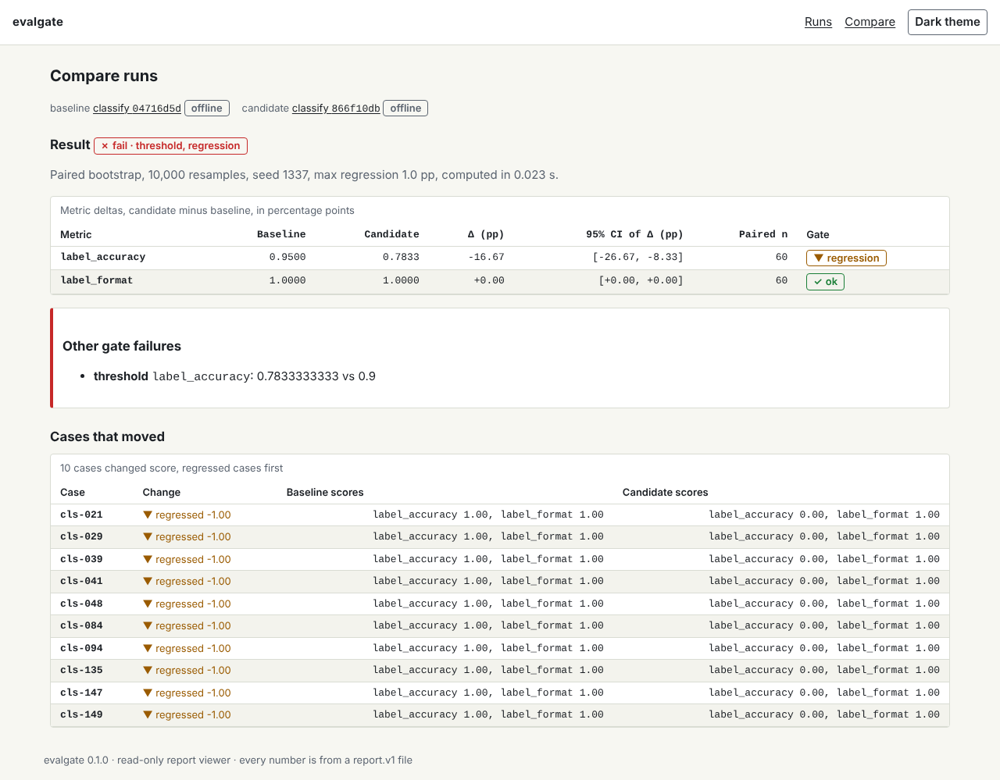
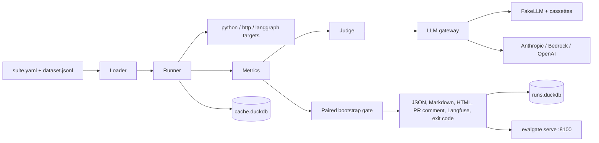
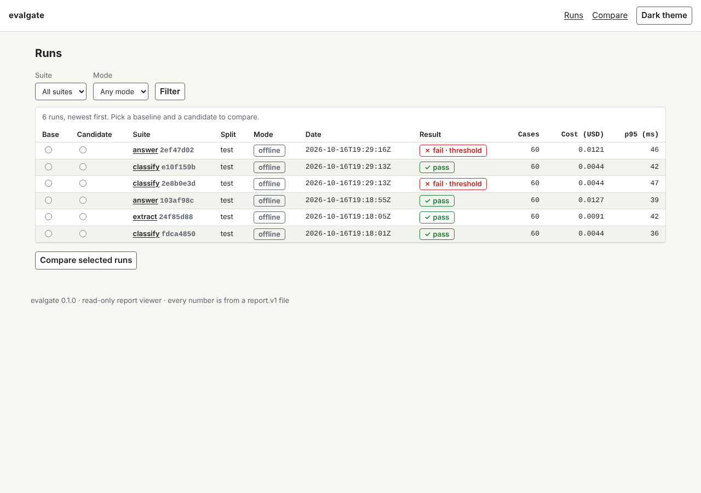
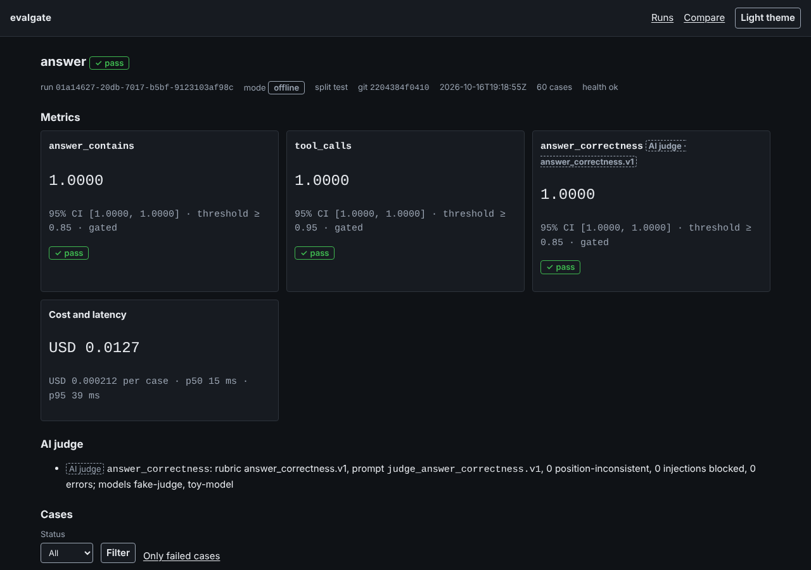
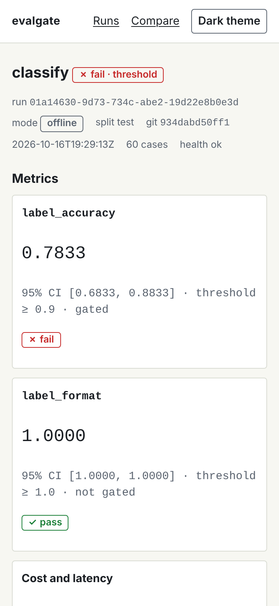

# evalgate

Library and CLI that turn golden sets, deterministic metrics and calibrated LLM judges into a CI gate that blocks quality, cost and latency regressions.

| | |
|---|---|
| Language | Python 3.12 and 3.13 |
| Install | `uv add evalgate` or `pip install evalgate` (extras: `anthropic`, `bedrock`, `openai`, `langgraph`, `langfuse`, `otel`, `ragas`, `deepeval`) |
| Local ports | 8100-8199 (viewer 8100, toy targets 8110) |
| API keys needed | None: tests, demo and `make verify` run offline |
| License | MIT |



## The problem

An engineer changes a prompt or a model, spot-checks a handful of cases and merges. Reviewers see a prompt diff and cannot tell whether quality, cost or latency moved, and uncalibrated LLM judges are not trusted. (These are the synthetic assumptions of the [product brief](docs/specs/000-build-spec.md#2-product-brief).)

## What evalgate does

- **Runs a suite** (`evalgate.suite.v1` YAML plus a JSONL golden set) against a Python callable, an HTTP endpoint or a LangGraph graph, with bounded concurrency, timeouts and retries; a failing case never aborts a run.
- **Scores** each case with deterministic metrics (`exact`, `regex`, `json_schema`, `numeric_tolerance`, `contains_all`, `tool_calls`, and `custom` plugins including Ragas and DeepEval adapters) and optional LLM judges that are adopted only after calibration against labels (agreement, Cohen's kappa, position and verbosity bias, prompt-injection pass-through).
- **Prices every step** from `src/evalgate/pricing.yaml` and enforces cost and p95 latency budgets; live judge runs print an estimate first and stop at `LIVE_EVAL_BUDGET_USD`.
- **Compares with a baseline** by paired percentile bootstrap (10,000 resamples, seed 1337) and fails on a threshold miss, a budget miss, an unhealthy run or a statistically supported regression larger than `--max-regression-pp`.
- **Reports** as stable JSON (`evalgate.report.v1`), Markdown, self-contained HTML, a PR comment upserted by a composite GitHub Action, Langfuse traces and an exit code; runs and a hash-chained gate audit go to DuckDB.
- **Shows** runs, run details and comparisons in a read-only viewer (`evalgate serve`), accessible in light and dark themes and at 375 px.

The model is only an optional judge: running, metrics, statistics, budgets, gating, caching and reporting are plain code, so every gate decision is reproducible without a key.

## Results

Every number below comes from the command and report named in its row. The reports are written to `evals/reports/` (gitignored) by the command; [`evals/REPORT.md`](evals/REPORT.md) is the generated summary. All runs are offline (FakeJudge and toy targets, synthetic data, seed 1337); live evals were not run because no provider key was available (`make eval-live` → `evals/reports/live-eval.json`, `ran: false`).

| What | Result | Target | Command → report |
|---|---|---|---|
| Injected regressions detected by the gate | 30 of 30 (1.00) | >= 0.90 | `make meta-eval` → `evals/reports/meta-eval.json` |
| Neutral changes that failed the gate | 0 of 20 (0.00) | <= 0.10 | `make meta-eval` → `evals/reports/meta-eval.json` |
| Judge `answer_correctness` agreement and kappa (64 test labels) | 0.875, kappa 0.746 | >= 0.80, >= 0.70 | `make calibrate` → `evals/reports/calibration-answer_correctness.json` |
| Judge `pairwise_preference` agreement and kappa (16 test labels) | 0.875, kappa 0.812 | >= 0.80, >= 0.70 | `make calibrate` → `evals/reports/calibration-pairwise_preference.json` |
| Judge `rubric_adherence` agreement and kappa (24 test labels) | 0.917, kappa 0.824 | >= 0.80, >= 0.70 | `make calibrate` → `evals/reports/calibration-rubric_adherence.json` |
| Injected candidates that passed the judge | 0 of 8 | 0 | `make calibrate` → `evals/reports/calibration-answer_correctness.json` |
| 95% bootstrap CI coverage (400 simulated datasets of 150 cases) | 0.96 | 0.92 to 0.98 | `make eval` → `evals/reports/bootstrap-coverage.json` |
| Classify v1 label accuracy (60 test cases) | 0.95 | >= 0.90 | `make eval` → `evals/reports/classify.json` |
| Demo: classify v2 against the v1 baseline | -16.67 pp, 95% CI [-26.67, -8.33], exit 1 | exit 1 | `make demo` → [`docs/demo-transcript.txt`](docs/demo-transcript.txt) |
| 200 cases at concurrency 16 against a 200 ms target | 2.8 s | < 300 s | `make bench` → `evals/reports/bench.json` |
| Engine overhead per case, p95 | 0.06 ms | < 5 ms | `make bench` → `evals/reports/bench.json` |
| Cached re-run of 200 judged cases | 1.3 s, 0 provider calls | < 10 s | `make bench` → `evals/reports/bench.json` |
| `import evalgate`, median of 5 | 3.0 ms | < 300 ms | `make bench` → `evals/reports/bench.json` |
| Wheel size | 0.12 MB | < 1 MB | `make bench` → `evals/reports/bench.json` |

The meta-evaluation's injected regressions are coarse and the judge labels are generated by construction, so these numbers show the gate and the judge pipeline work on known answers; they do not show agreement with human judgment on real data. See [ADR-0006](docs/adr/0006-labels-by-construction.md) and [known limitations](docs/KNOWN_LIMITATIONS.md).

## Quick start

Reviewer path, under five minutes with Docker:

```bash
git clone https://github.com/ROBERTG99/evalgate.git && cd evalgate
make up          # docker compose up -d --build --wait, then seed the viewer
open http://localhost:8100
make demo        # v2 is blocked (exit 1), switching back to v1 passes (exit 0)
```

The same without Make: `docker compose up -d --wait` and `docker compose --profile tools run --rm seed`.

Developer path (uv, Python 3.12+):

```bash
make bootstrap   # uv sync --all-extras, pinned CLI tools into .tools/bin, .env from .env.example
make check-fast  # ruff and unit tests
make verify      # lint, types, schemas, security, tests, evals, benchmarks, build
```

## Using the gate

A suite names a dataset, a target, metrics with thresholds and budgets:

```yaml
schema: evalgate.suite.v1
name: classify
dataset: evals/datasets/toys/classify.v1.jsonl
target:
  http: {url: "${EVALGATE_TOYS_URL:-http://localhost:8110}/classify", method: POST}
metrics:
  - {name: label_accuracy, kind: exact, params: {actual: output.label, expected: expected.label}, threshold: 0.90}
budget: {max_cost_usd: 0.01, max_p95_ms: 800}
splits: [dev, test]
```

```bash
evalgate run evals/suites/classify.yaml --split test --out report.json
evalgate check report.json --baseline evals/baselines/classify.json --max-regression-pp 1.0
```

Exit codes: 0 pass, 1 gate failed, 2 invalid input, 3 budget stop before or during a live run, 4 internal error, 5 exporter failure with `--strict`. A judge that stays unavailable after retries is a metric error, so `run` still writes the report and `check` fails closed with exit 1 ([`docs/contracts/check.md`](docs/contracts/check.md)).

In GitHub Actions, from any repository (the target can be any HTTP service, so the system under test need not be Python):

```yaml
- uses: ROBERTG99/evalgate/action@v0.1.0
  with:
    suite: evals/suites/classify.yaml
    baseline: evals/baselines/classify.json
    max-regression-pp: "1.0"
```

The action runs the suite, gates it, writes the Markdown report to the job summary and upserts one PR comment per suite; [`evals.yml`](.github/workflows/evals.yml) also uploads the reports as artifacts ([`docs/contracts/action.md`](docs/contracts/action.md)).

## Architecture



Details in [`docs/architecture.md`](docs/architecture.md); design decisions in [`docs/adr/`](docs/adr/README.md) and [`docs/design-faq.md`](docs/design-faq.md).

## Screenshots

Captured by Playwright in `make e2e` (`tests/e2e/test_viewer.py::test_screenshots`).

| Runs list | Run detail (dark) | Mobile (375 px) |
|---|---|---|
|  |  |  |

## Documentation

| Topic | Where |
|---|---|
| Architecture and flows | [`docs/architecture.md`](docs/architecture.md) |
| Contracts (suite, report, check, rubric, cassette, action) | [`docs/contracts/`](docs/contracts/README.md) |
| How evalgate evaluates itself | [`docs/evaluation.md`](docs/evaluation.md), [`evals/REPORT.md`](evals/REPORT.md) |
| Design FAQ (15 questions with code references) | [`docs/design-faq.md`](docs/design-faq.md) |
| Security model and scan results | [`docs/security.md`](docs/security.md), [`SECURITY.md`](SECURITY.md) |
| Operations, alerts, releases, baseline rotation | [`docs/runbook.md`](docs/runbook.md) |
| Development setup | [`docs/DEVELOPMENT.md`](docs/DEVELOPMENT.md), [`CONTRIBUTING.md`](CONTRIBUTING.md) |
| How it was built with Claude Code | [`docs/ai-development.md`](docs/ai-development.md), [`docs/specs/000-build-spec.md`](docs/specs/000-build-spec.md) |
| Decisions and known limitations | [`docs/DECISIONS.md`](docs/DECISIONS.md), [`docs/KNOWN_LIMITATIONS.md`](docs/KNOWN_LIMITATIONS.md) |
| Verification record | [`docs/verification.md`](docs/verification.md) |

Part of a 10-repository AI engineering portfolio by [@ROBERTG99](https://github.com/ROBERTG99). All data is synthetic.
