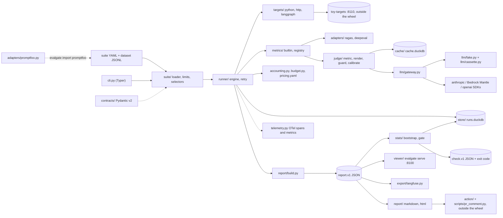
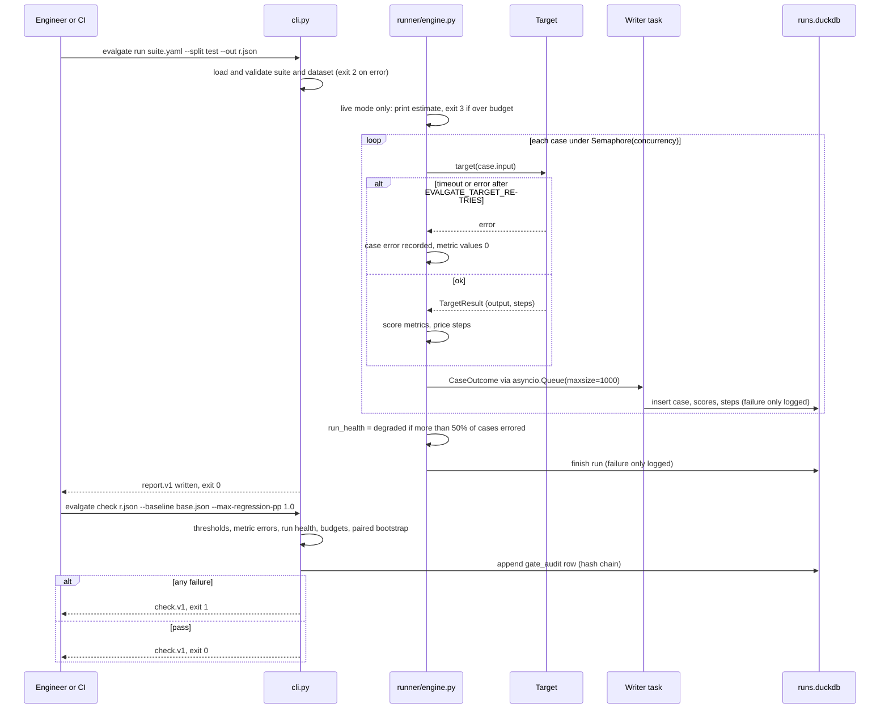
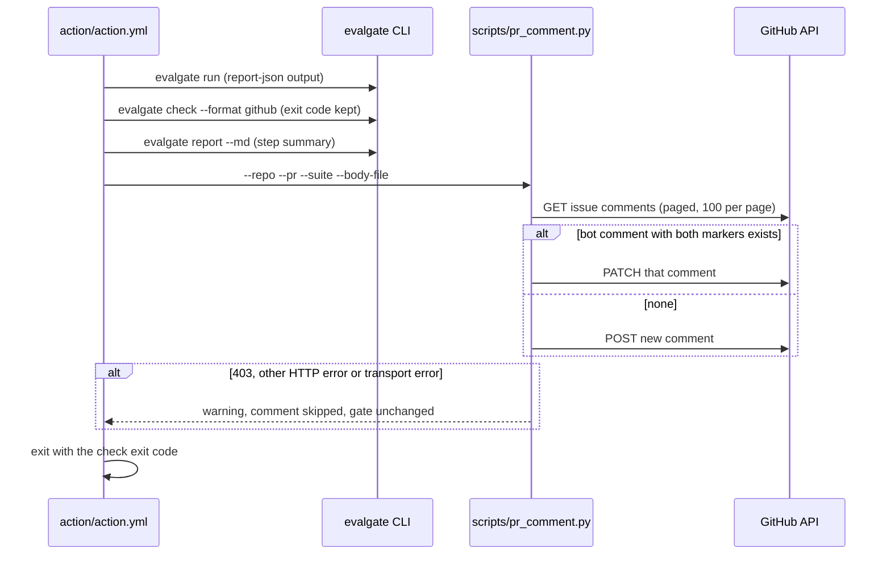

# Architecture

evalgate is a library and a CLI. It loads a suite, calls a target for every case, scores the outputs with deterministic metrics and calibrated LLM judges, prices every step, writes a `evalgate.report.v1` JSON report, and then gates that report against thresholds, budgets and a baseline. There is no server component to deploy: the viewer and the toy targets exist for local review and for evaluating evalgate itself.

The build specification is [`docs/specs/000-build-spec.md`](specs/000-build-spec.md) (§4). Decisions without an ADR are in [`DECISIONS.md`](DECISIONS.md); known gaps are in [`KNOWN_LIMITATIONS.md`](KNOWN_LIMITATIONS.md).

## Components

Every box below is a module under `src/evalgate/` unless it is marked as outside the wheel.



- **Loading.** `suite/loader.py` validates the suite and dataset against the contracts (`extra="forbid"`) and exits 2 naming the file, JSON path or line. `${VAR:-default}` interpolation applies only inside `target`. `suite/limits.py` enforces 1 MB per suite and dataset row and 100,000 cases.
- **Running.** `runner/engine.py` schedules cases under `asyncio.Semaphore(suite.concurrency)`, applies per-case and per-run timeouts, retries through `runner/retry.py`, and never lets one failing case abort the run. Sync Python targets run in a worker thread; HTTP targets share one pooled `httpx.AsyncClient` per run and must match `EVALGATE_HTTP_ALLOWED_HOSTS`; LangGraph targets emit one `StepRecord` per node.
- **Scoring.** `metrics/builtin.py` holds `exact`, `json_schema`, `numeric_tolerance`, `contains_all`, `regex` and `tool_calls`; `metrics/registry.py` holds `@evalgate.metric("name")`. Judge metrics (`judge/metric.py`) go through `judge/context.py`, which owns the cache, the judge semaphore (`EVALGATE_JUDGE_CONCURRENCY`, default 4) and the counters.
- **Accounting.** `accounting.py` prices steps from `pricing.yaml` and computes p50/p95; `budget.py` prints the live estimate, aborts with exit 3 before any provider call when it is over `LIVE_EVAL_BUDGET_USD`, and keeps a hard stop during the run.
- **Gating.** `stats/bootstrap.py` is a seeded percentile bootstrap (numpy `PCG64`, 10,000 resamples); `stats/gate.py` applies thresholds, budgets, run health and paired regressions, and fails closed on metric errors and on gated metrics with fewer than 10 paired cases (`MIN_PAIRED`).
- **Output.** `report/build.py` writes report.v1; `report/markdown.py` and `report/html.py` render it; `viewer/server.py` serves it; `export/langfuse.py` sends one trace per case and one score per metric.

## Main flows

### Run and check



The run store is optional: if `runs.duckdb` cannot be opened or written, the report is still written and carries `extensions.store_error`. `--resume <run_id>` skips the cases already stored for that run.

### Judge call with cache, position swap and provider failure

```mermaid
sequenceDiagram
  participant M as judge/metric.py
  participant X as judge/context.py
  participant C as cache.duckdb
  participant G as llm/gateway.py
  participant P as Provider or FakeLLM
  M->>M: injection pattern match on candidate
  alt pattern found
    M-->>M: value 0, verdict fail, no model call
  else clean
    loop order 1 and order 2 (position swap)
      M->>X: verdict(rendered prompt)
      X->>C: get(cassette key)
      alt usable hit (same mode namespace, same request digest)
        C-->>X: verdict
      else miss
        X->>G: complete(request, schema judge_verdict.v1)
        G->>G: redact PII, check live budget
        G->>P: request (retry 408, 409, 429, 5xx, connection, timeout; max 3 attempts)
        alt still failing or invalid output
          G-->>M: JudgeUnavailable or OutputError
          M-->>M: value 0, metric_error, gate fails closed
        else ok
          P-->>G: verdict JSON
          G-->>X: validated verdict, tokens, cost
          X->>C: put(key, verdict) ON CONFLICT DO NOTHING
        end
      end
    end
    M->>M: verdicts differ across orders: position_inconsistent, value 0.5
  end
```

Pointwise rubrics swap the reference before and after the candidate; pairwise rubrics swap A and B and mirror the second verdict. Offline verdicts (rules, cassettes) and live verdicts live in separate cache namespaces, and a row whose request digest differs is treated as stale. A budget abort (exit 3) is never swallowed by the metric. There is no fallback from a live provider to the fake one inside a run.

### PR comment upsert



The comment starts with `<!-- evalgate:report -->` and carries `<!-- evalgate:suite=<name> -->`, so each suite owns exactly one comment. Only comments written by `github-actions[bot]` (type `Bot`) are edited, so markers pasted by someone else are ignored. Bodies are cut at 60,000 characters.

## Data stores

All local state lives under `EVALGATE_HOME` (default `.evalgate/`).

| Store | File | Written by | Contents |
|---|---|---|---|
| Run store | `runs.duckdb` | `store/runstore.py` | `runs`, `case_results`, `metric_scores`, `steps`, `gate_audit`, `audit_anchor`, `schema_version` |
| Response cache | `cache.duckdb` | `cache/__init__.py` | `responses` keyed by cassette key, `schema_version` |
| Reports | any path given to `--out` | `report/build.py` | report.v1 JSON; the viewer reads a directory of them |
| Check results | path given to `--out-json` | `cli.py check` | check.v1 JSON |
| Baselines | `evals/baselines/*.json` | maintainers | committed report.v1 files, append-only |

`runs.duckdb` tables (migrations in `src/evalgate/store/migrations/`):

- `001_init.sql`: `runs` (one row per run, `split` and `mode` checked, index on `(suite, created_at)`), `case_results` (PK `(run_id, case_id)`), `metric_scores` (PK `(run_id, case_id, metric)`, `details JSON`), `steps` (PK `(run_id, case_id, step)`, `kind` and `status` checked), and `gate_audit` (append-only; each row stores `prev_hash` and `hash = sha256(prev_hash + canonical_json(record))`).
- `002_audit_anchor.sql`: `audit_anchor(seq, hash, pruned_at)`, written by `evalgate gc` when retention prunes the head of `gate_audit`, so `evalgate gc --verify-audit` can tell retention from tampering.

`cache.duckdb` has one migration (`src/evalgate/cache/migrations/001_init.sql`): `responses(key, route, model, prompt_version, request_digest, response JSON, input_tokens, output_tokens, cost_usd, latency_ms, created_at, hits)`, inserted with `ON CONFLICT DO NOTHING` (a live response may replace an offline one). If the file stays locked by another process for more than 5 seconds, the cache falls back to read-only, then to off.

Migrations are SQL files named `NNN_<name>.sql`, applied in order, each in one transaction, and tracked in `schema_version(version, applied_at)` (`src/evalgate/store/db.py`). Retention: `evalgate gc` prunes runs after `--keep-days` (default 30), `gate_audit` rows after 365 days and cache rows after `EVALGATE_CACHE_TTL_DAYS` (default 90). CI keeps `.evalgate/*.duckdb` as a 14-day artifact (`.github/workflows/evals.yml`).

## Deployment view

evalgate itself is installed with pip or uv, or used as the composite action `action/action.yml`. Docker Compose runs the local review stack; every port binds `127.0.0.1` in the 8100 to 8199 range.

| Service | Compose file and profile | Host port | Role |
|---|---|---|---|
| `toy-targets` | `compose.yaml`, default | 8110 | FastAPI toy systems `/classify`, `/extract`, `/answer`, `/healthz`, `/metrics` |
| `report-viewer` | `compose.yaml`, default | 8100 | `evalgate serve /reports` on the `reports` volume |
| `seed` | `compose.yaml`, `tools` | none | `scripts/seed_reports.py`: v1 and v2 suites into `reports` |
| `otel-collector` | `compose.yaml`, `observability` | 8180 (gRPC), 8181 (HTTP) | OTLP in; traces to Jaeger, metrics to a Prometheus exporter on 8889 inside the network |
| `prometheus` | `compose.yaml`, `observability` | 8191 | Scrapes `toy-targets:8110` and `otel-collector:8889`; loads `deploy/prometheus/alerts.yml` |
| `grafana` | `compose.yaml`, `observability` | 8190 | Dashboard `deploy/grafana/dashboards/evalgate.json` |
| `jaeger` | `compose.yaml`, `observability` | 8192 | Trace UI |
| `langfuse-web`, `langfuse-worker` | `compose.yaml`, `langfuse` | 8193 | Local Langfuse for `evalgate export langfuse` |
| `langfuse-postgres`, `-redis`, `-clickhouse`, `-minio` | `compose.yaml`, `langfuse` | 8120, 8130, 8140, 8141 | Langfuse backing stores |
| `tests` | `compose.test.yaml` | none | Unit, integration, contract and harness tests in a container |
| `e2e` | `compose.test.yaml` | none | Playwright and axe against `report-viewer:8100` |
| `wiremock-langfuse`, `wiremock-github` | `compose.test.yaml` | 8142, 8143 | Real WireMock with the same mappings as the in-process doubles |
| `promtool` | `compose.test.yaml` | none | `promtool test rules` on `deploy/prometheus/alerts.test.yml` |

`compose.test.yaml` joins the main stack's network (`evalgate_default`, external), so `make test-docker` (`scripts/test_docker.sh`) starts and seeds the main stack first. Images are built from `docker/evalgate.Dockerfile` and `docker/toy-targets.Dockerfile` with a `python:3.13-slim` builder and a distroless runtime (see [`DECISIONS.md`](DECISIONS.md)). Releases publish the wheel and sdist to GitHub Releases and PyPI and the two images to GHCR (`.github/workflows/release.yml`); see [`runbook.md`](runbook.md#release).

## Module map

| Module | Responsibility | Key file |
|---|---|---|
| `contracts/` | Pydantic v2 models for suite, dataset row, records, report, check, rubric, verdict, cassette; source of `schemas/*.json` | `src/evalgate/contracts/__init__.py` |
| `suite/` | YAML suite and JSONL dataset loading, `${VAR:-default}` in `target`, size limits, dotted selectors | `src/evalgate/suite/loader.py` |
| `runner/` | Async scheduling, timeouts, retries, resume, writer queue, run health | `src/evalgate/runner/engine.py` |
| `targets/` | `python`, `http` (host allowlist), `langgraph` (one StepRecord per node) | `src/evalgate/targets/http.py` |
| `metrics/` | Deterministic metrics and the `@evalgate.metric` registry | `src/evalgate/metrics/builtin.py` |
| `judge/` | Judge metric, prompt rendering with tag isolation, injection guard, position swap, FakeJudge, calibration | `src/evalgate/judge/metric.py` |
| `llm/` | The only provider SDK importer: provider selection, PII redaction, retries, budget guard, cassettes, FakeLLM | `src/evalgate/llm/gateway.py` |
| `accounting.py`, `budget.py` | Step cost from `pricing.yaml`, latency percentiles, live estimate and spend guard | `src/evalgate/budget.py` |
| `stats/` | Paired percentile bootstrap, gate rule, coverage simulation | `src/evalgate/stats/gate.py` |
| `report/` | report.v1 builder, Markdown, self-contained HTML, check text | `src/evalgate/report/build.py` |
| `export/` | Langfuse exporter over the public ingestion HTTP API | `src/evalgate/export/langfuse.py` |
| `store/` | DuckDB run store, migrations, hash-chained gate audit, retention | `src/evalgate/store/runstore.py` |
| `cache/` | DuckDB response cache with modes rw, ro, off and lock fallback | `src/evalgate/cache/__init__.py` |
| `viewer/` | Read-only report viewer on stdlib `ThreadingHTTPServer` with Jinja2 | `src/evalgate/viewer/server.py` |
| `adapters/` | `ragas:` and `deepeval:` metrics, Promptfoo importer | `src/evalgate/adapters/promptfoo.py` |
| `testing/` | Public test helpers `Cassette`, `FakeJudge`, `FakeLLM` | `src/evalgate/testing/__init__.py` |
| `telemetry.py` | OTel spans and `evalgate_*` metrics when `--otel` or `OTEL_EXPORTER_OTLP_ENDPOINT` is set; JSON logs | `src/evalgate/telemetry.py` |
| `config.py`, `errors.py`, `ids.py` | Environment settings, exceptions with exit codes, UUIDv7 run ids and canonical JSON | `src/evalgate/config.py` |
| `cli.py` | Typer commands `run`, `check`, `report`, `calibrate`, `serve`, `import`, `export`, `gc`, `schema`; exit codes 0 to 5 | `src/evalgate/cli.py` |

Outside the wheel: `examples/toy-targets/` (uv workspace member), `data/generator/` (seeded data), `scripts/`, `action/`, `evals/`, `prompts/` (the three judge prompts are force-included in the wheel as `evalgate/prompts/`).

## Key design constraints

- **Offline first.** The default provider is `fake` (`EVALGATE_LLM_PROVIDER`); FakeLLM replays cassettes or answers with FakeJudge rules. Tests run with `pytest-socket`, which blocks non-loopback sockets, and `tests/integration/test_offline_guard.py` checks that a full offline judged run opens no outside connection. Live calls happen only with a provider configured, for example through `make eval-live`.
- **One provider gateway.** Only `src/evalgate/llm/gateway.py` imports `anthropic` or `openai`, and it imports them inside functions. Model IDs come from `EVALGATE_JUDGE_MODEL` and `EVALGATE_JUDGE_HARD_MODEL`, never from logic.
- **Heavy imports are lazy.** `import evalgate` loads no numpy, DuckDB, httpx or provider SDK (`src/evalgate/__init__.py` resolves public names on first access); CLI commands import their dependencies inside the command. The budget is 300 ms (NFR-6); the measured value is in [`evaluation.md`](evaluation.md#benchmarks).
- **Small wheel.** The wheel holds only `src/evalgate` plus the judge prompts; `scripts/check_wheel.py` fails `make build` over 1 MB or on files outside the package (NFR-7).
- **Fail closed.** Judge errors, invalid judge output, degraded runs and gated metrics the baseline cannot pair all fail the gate.

## Architecture decision records

- [ADR-0001: DuckDB over SQLite and Postgres](adr/0001-duckdb.md)
- [ADR-0002: thin provider gateway over LiteLLM](adr/0002-thin-provider-gateway.md)
- [ADR-0003: paired bootstrap over a paired t-test](adr/0003-paired-bootstrap.md)
- [ADR-0004: YAML suites over Python-only configuration](adr/0004-yaml-suites.md)
- [ADR-0005: composite action over a Docker action](adr/0005-composite-action.md)
- [ADR-0006: judge labels by construction](adr/0006-labels-by-construction.md)
- [ADR-0007: stdlib viewer server over FastAPI in the wheel](adr/0007-stdlib-viewer.md)
